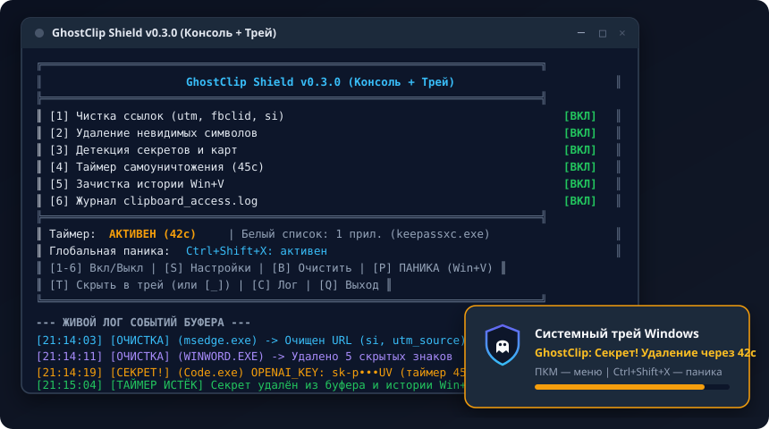
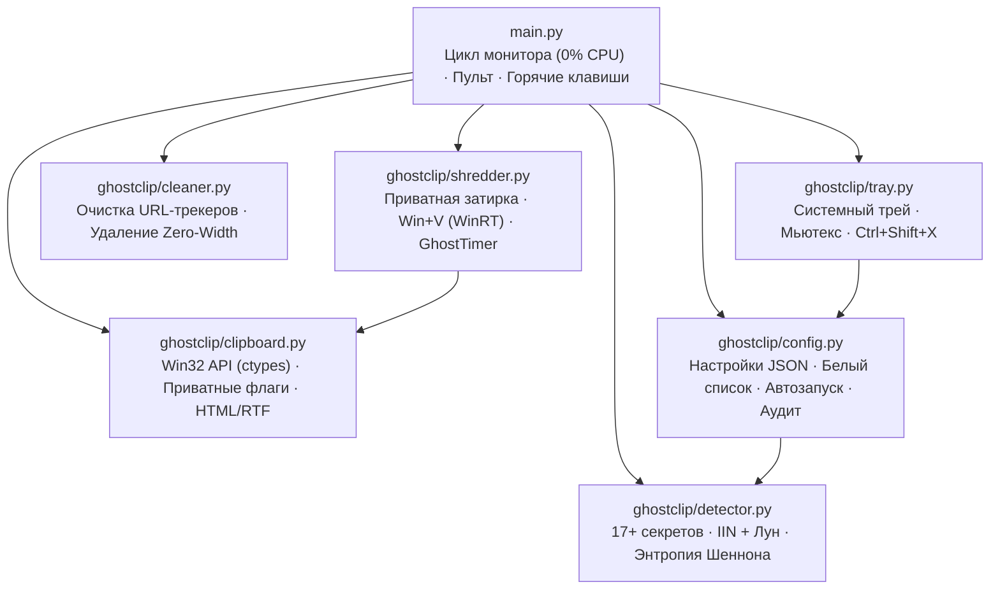

# 👻 GhostClip Shield (Консоль + Системный Трей)

[](https://github.com/kdkdamls4-boop/GhostClip/actions/workflows/ci.yml)
[](https://github.com/kdkdamls4-boop/GhostClip/releases/latest)


-2EA043)
[](LICENSE)

> **Персональный защитник буфера обмена для Windows 10/11 (`v0.3.0`):** работает в консоли и системном трее с нулевой нагрузкой на CPU, очищает ссылки от трекеров, перехватывает секреты и карты с автоудалением, затирает историю `Win + V`, ведёт приватный ротируемый журнал и собирается в автономный `GhostClip.exe` **без единой сторонней зависимости**.



---

## ⬇️ Скачать готовый релиз (`GhostClip.exe`)

Готовый автономный бинарник (не требует установленного Python) публикуется на странице релизов:

👉 **[Скачать последний релиз (`GhostClip.exe` и `SHA256SUMS.txt`)](https://github.com/kdkdamls4-boop/GhostClip/releases/latest)**

После скачивания проверьте целостность файла в PowerShell:

```powershell
Get-FileHash .\GhostClip.exe -Algorithm SHA256
```

Хэш должен совпадать с содержимым `SHA256SUMS.txt` из того же релиза.

> **Примечание о Windows SmartScreen:** проект распространяется с открытым исходным кодом без коммерческого сертификата подписи (Code Signing). Подробнее о модели угроз, приватности и проверке бинарника см. в [SECURITY.md](SECURITY.md).

---

## ✨ Ключевые возможности и защита

| Направление | Что реализовано в `v0.3.0` | Модуль |
|---|---|---|
| 🧹 **Очистка ссылок** | Удаление `30+` трекинг-параметров (`utm_*`, `hsa_*`, `fbclid`, `gclid`, `yclid`, `si`, `ttclid`, `igshid` и др.) с сохранением полезных параметров (`v=`, `id=`) и форматирования HTML/RTF | `ghostclip/cleaner.py` |
| 🥷 **Удаление Zero-Width** | Вырезание 12 невидимых символов слежки и водяных знаков (`\u200B`–`\u200F`, `\u202A`–`\u202E`, `\u2060`, `\uFEFF`) | `ghostclip/cleaner.py` |
| 🔍 **Детекция секретов и карт** | `17` типов токенов (OpenAI, Anthropic, AWS, GitHub/PAT, Google API, Slack, Stripe, GitLab, npm, Hugging Face, SendGrid, Azure, Telegram, JWT, БД-строки, PEM-ключи), карты по **IIN + Луну** (Visa, Mastercard, МИР, Amex, UnionPay, JCB, Discover, Maestro) и пароли по энтропии Шеннона (`>= 3.6`) | `ghostclip/detector.py` |
| ⏱️ **Таймер и паника** | Потокобезопасный таймер (`5..3600с`) с защитой от гонок (`epoch`), приватная перезапись (`CanIncludeInClipboardHistory=0`, `CanUploadToCloudClipboard=0`) и очистка `Win + V` через WinRT; глобальная паника `Ctrl + Shift + X` | `ghostclip/shredder.py`, `ghostclip/clipboard.py` |
| 🛡️ **Трей и одиночный запуск** | Иконка щита в трее с индикацией таймера, защитой от закрытия `[X]`, ПКМ-меню и мьютексом `Local\GhostClipShield` | `ghostclip/tray.py` |
| 📜 **Приватный аудит и автозапуск** | Обычный текст в `clipboard_access.log` не сохраняется (`[текст, N симв.]`), секреты маскируются, ротация на `1 МБ`, белый список `.exe` и автозапуск через реестр `HKCU\...\Run` | `ghostclip/config.py` |

---

## 🚀 Быстрый запуск из исходников

Для работы нужен только стандартный **Python 3.10+** на Windows 10/11. Сторонние библиотеки (`pip install`) для работы самой программы не нужны — трей, глобальная горячая клавиша и перехват буфера работают напрямую через Win32 API (`ctypes`).

```bash
# Запуск программы:
python main.py

# Запуск учебной копии (та же логика с подробными комментариями на русском):
python explained/main.py
```

---

## 🛡️ Системный трей Windows (иконка щита и индикация таймера)

Сразу после запуска возле системных часов появляется **иконка щита**:

1. **Глобальная горячая клавиша паники `Ctrl + Shift + X`:**
   * Мгновенно затирает буфер обмена **и** историю `Win + V` из любого открытого окна (браузера, редактора, мессенджера), даже когда консоль свернута в трей.
2. **Визуальная индикация таймера в трее:**
   * Пока тикает таймер самоуничтожения секрета, иконка в трее переключается на предупреждающую, а при наведении мыши показывает обратный отсчёт (`GhostClip: Секрет! Удаление через Nс`).
   * По истечении таймера, а также при сворачивании в трей, ручной очистке или панике показывается системное уведомление.
3. **Защита от случайного закрытия и ПКМ-меню:**
   * Нажмите **`T`** или кнопку свернуть **`[_]`** — консоль спрячется в трей, продолжая защиту в фоне. Системный крестик `[X]` отключён от случайного закрытия.
   * По ПКМ доступны: открытие/скрытие консоли, очистка буфера, паника (`Ctrl+Shift+X`), переключатели `[1]–[6]` и выход.

---

## 🎮 Единый пульт управления в консоли

```text
╔═══════════════════════════════════════════════════════════════════════╗
║                GhostClip Shield v0.3.0 (Консоль + Трей)                ║
╠═══════════════════════════════════════════════════════════════════════╣
║  [1] Чистка ссылок (utm, fbclid, si)                           [ВКЛ]  ║
║  [2] Удаление невидимых символов                               [ВКЛ]  ║
║  [3] Детекция секретов и карт                                  [ВКЛ]  ║
║  [4] Таймер самоуничтожения (45с)                              [ВКЛ]  ║
║  [5] Зачистка истории Win+V                                    [ВКЛ]  ║
║  [6] Журнал clipboard_access.log                               [ВКЛ]  ║
╠═══════════════════════════════════════════════════════════════════════╣
║  Таймер: Ожидание...           | Белый список: пуст                   ║
║  Глобальная паника: Ctrl+Shift+X: активен                             ║
║  [1-6] Вкл/Выкл | [S] Настройки | [B] Очистить | [P] ПАНИКА (Win+V)   ║
║  [T] Скрыть в трей (или [_])    | [C] Лог      | [Q] Выход            ║
╚═══════════════════════════════════════════════════════════════════════╝

--- ЖИВОЙ ЛОГ СОБЫТИЙ БУФЕРА ---
[*] Ожидание событий буфера обмена...
```

### Горячие клавиши в консоли (работают без `Enter`, в RU и EN раскладке):

| Клавиша | Действие |
|:---:|---|
| **`1` – `6`** | Включить / выключить соответствующую функцию (с сохранением в `ghostclip_settings.json`) |
| **`S`** *(рус. `Ы`)* | **Настройки:** время таймера (`5..3600` сек), белый список (`.exe`) и автозапуск с Windows |
| **`B`** *(рус. `И`)* | **Очистить буфер обмена** (удаляет только текущий текст в буфере) |
| **`P`** *(рус. `З`)* | **ПАНИКА** — затирает буфер обмена **и** историю `Win + V` *(снаружи окна: `Ctrl+Shift+X`)* |
| **`T`** *(рус. `Е`)* | **Скрыть консоль в трей** (вернуть можно по ПКМ или 2×ЛКМ по иконке) |
| **`C`** *(рус. `С`)* | Очистить живой лог на экране |
| **`Q`** *(рус. `Й`)* | Полный выход из программы |

---

## 🏗️ Архитектура проекта



---

## 📦 Сборка в автономный `.exe`

При необходимости программу можно упаковать в один исполняемый файл с фирменной иконкой `assets/ghostclip.ico` без требования установленного Python (в `.exe`-режиме настройки `ghostclip_settings.json` и журнал `clipboard_access.log` сохраняются рядом с `GhostClip.exe`):

```bash
pip install pyinstaller
pyinstaller --clean ghostclip.spec
# Готовый файл появится в dist/GhostClip.exe
```

---

## 🧪 Тесты, линтер и CI

```bash
# Запуск 52 модульных и интеграционных Win32-тестов (включая AST-сверку explained/):
python run_tests.py

# Прогон тестов на учебной копии explained/:
python -c "import sys, unittest; sys.path.insert(0, 'explained'); suite = unittest.defaultTestLoader.discover('tests', pattern='test_*.py'); result = unittest.TextTestRunner(verbosity=2).run(suite); sys.exit(0 if result.wasSuccessful() else 1)"

# Проверка стиля и форматирования (конфигурация в pyproject.toml):
ruff check .
ruff format --check .
```

Автоматическая проверка `ruff`, прогон **52 автотестов** (включая реальные Win32 интеграционные тесты в `tests/test_integration_win32.py` и AST-сверку `explained/` в `tests/test_explained_sync.py`) на обеих версиях пакета, сборка `GhostClip.exe` с `SHA256SUMS.txt` в CI ([.github/workflows/ci.yml](.github/workflows/ci.yml)) и публикация релизов по тегам `v*` ([.github/workflows/release.yml](.github/workflows/release.yml)).

---

## 📁 Структура проекта

```text
.
├── main.py                  # ⭐ Главная точка входа (одиночный запуск, VT-консоль, [S] настройки и защита)
│
├── ghostclip/               # 📦 Компактное ядро (6 рабочих модулей + __init__.py)
│   ├── __init__.py          # Экспорт компонентов пакета и __version__
│   ├── config.py            # ⚙️ Переключатели [1-6], JSON-настройки, автозапуск, ротируемый приватный лог
│   ├── cleaner.py           # 🧹 Очистка ссылок (utm_*, hsa_*, fbclid, si, ttclid...) и Zero-Width
│   ├── detector.py          # 🔍 17+ форматов токенов, IIN-карты (Лун), энтропия паролей
│   ├── clipboard.py         # 🪟 Win32 API (64-bit, приватные форматы Win+V/облака, проверка HTML/RTF)
│   ├── shredder.py          # 🗑️ Приватная затирка буфера, очистка Win+V (WinRT) и потокобезопасный таймер
│   └── tray.py              # 🛡️ Системный трей, мьютекс одиночного запуска, Ctrl+Shift+X и ПКМ-меню
│
├── explained/               # 🎓 Учебная версия (1-в-1 копия с подробными комментариями + основы Python)
│   ├── 00_ОСНОВЫ_PYTHON.md
│   ├── main.py
│   ├── README.md
│   └── ghostclip/
│
├── assets/                  # 🎨 Иконка ghostclip.ico для .exe и визуальное превью preview.svg
├── tests/                   # 🧪 52 автотеста (юнит, AST-синхронность explained/ и Win32 интеграционные)
├── .github/workflows/       # ⚙️ CI/CD: ruff, 52×2 теста, сборка GhostClip.exe + SHA256SUMS.txt и релизы
├── CHANGELOG.md             # 📋 История версий и изменений
├── SECURITY.md              # 🔐 Модель угроз, политика приватности и проверка SHA-256
├── LICENSE                  # 📄 Лицензия MIT
├── ghostclip.spec           # 📦 Конфигурация сборки GhostClip.exe для PyInstaller (upx=False, icon)
├── pyproject.toml           # 🔧 Конфигурация линтера и форматтера ruff
├── run_tests.py             # Запуск всех тестов (python run_tests.py)
├── demo_generator.py        # Генератор тестовых секретов и грязных ссылок
├── TEST_SAMPLES.md          # Готовые примеры для ручной проверки
└── requirements.txt         # 0 внешних зависимостей для работы программы
```

---

## 🗺️ Перспективы развития (Roadmap `v0.4.0+`)

- **Тихий автозапуск (`--minimized`):** скрытый запуск сразу в системный трей при входе в Windows без всплытия консоли.
- **Событийный перехват (`WM_CLIPBOARDUPDATE`):** переход от интервала опроса `0.2с` на `AddClipboardFormatListener` в окне трея.
- **Автоочистка при блокировке ПК (`Win + L`) и уходе в сон:** перехват `WM_WTSSESSION_CHANGE` и `WM_POWERBROADCAST`.
- **Пауза защиты (Snooze 5/15 мин)** в меню трея и настраиваемая глобальная горячая клавиша паники.
- **Анти-клиппер и защита от Paste-Jacking:** обнаружение мгновенной подмены криптокошельков/карт сторонним процессом, гомоглифов URL и скрытых переносов строк/Escape-кодов в командах.
- **Опциональный GUI на стандартном `tkinter`:** окно настроек и сводки журнала аудита без добавления внешних зависимостей.

---

Подробности об изменениях см. в [CHANGELOG.md](CHANGELOG.md), политика безопасности описана в [SECURITY.md](SECURITY.md), распространяется под лицензией [MIT](LICENSE).
