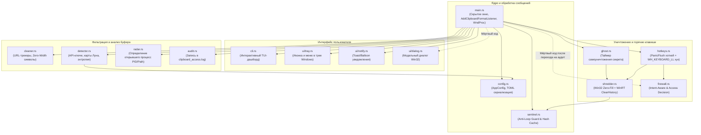

# 🛡️ GhostClip Shield (GCB) — Полный отчёт Code Review

> **Дата проведения:** 2026-10-14  
> **Анализируемый коммит / ревизия:** `e9f7edb` (*feat: replace intrusive blocking with transparent audit log*)  
> **Стек проекта:** Rust 1.99.0 (edition 2024), Win32 API (`windows-rs` 0.58), WinRT (`Windows.ApplicationModel.DataTransfer`), crossterm TUI  
> **Объём кодовой базы:** ~2 600 строк кода на Rust, 16 модулей  
> **Результаты автотестов и линтеров:** 16/16 тестов пройдено ✅ | 27 clippy warnings ⚠️ | 50 rustfmt diffs ⚠️  

---

## 1. Архитектурная диаграмма системы



---

## 2. Сводная таблица найденных дефектов

| ID | Категория | Уровень | Файл:Строки | Краткая суть проблемы |
|---|---|---|---|---|
| **BUG-001** | 🐛 Баг | 🔴 Critical | `src/main.rs:75` | Undefined Behavior: `std::slice::from_raw_parts(..., usize::MAX / 2)` |
| **BUG-002** | 🐛 Баг | 🔴 Critical | `src/radar.rs:67-87` | Логическая ошибка: радар перехватывает писателя (активное окно), а не читателя буфера |
| **BUG-003** | 🐛 Баг | 🟠 High | `src/ghost.rs:28-50` | `arm_timer` порождает неуправляемые потоки ОС при каждом секрете |
| **BUG-004** | 🐛 Баг | 🟠 High | `src/shredder.rs:41-54` | Утечка глобальной памяти: `GlobalAlloc` выделяет 64 байта без `SetClipboardData` и `GlobalFree` |
| **BUG-005** | 🐛 Баг | 🟠 High | `src/sentinel.rs:26-36` | Состояние гонки: Guard уничтожается до асинхронной обработки `WM_CLIPBOARDUPDATE` |
| **SEC-001** | 🔒 Безопасность | 🟠 High | `src/hotkeys.rs:19` | `static mut KEYBOARD_HOOK` — гонка данных и UB в Rust 2024 |
| **SEC-002** | 🔒 Безопасность | 🟠 High | `src/audit.rs:37-84` | Пароли, токены и номера карт записываются в открытый plaintext-файл журнала |
| **TEST-001** | 🧪 Тесты | 🟠 High | `src/{audit, radar, shredder, ghost, hotkeys}.rs` | Полное отсутствие тестов в критических модулях безопасности |
| **BUG-006** | 🐛 Баг | 🟡 Medium | `src/main.rs:140, 235, 386` | Вызов `.unwrap()` на `Mutex::lock()` приводит к крашу при отравлении мьютекса |
| **BUG-007** | 🐛 Баг | 🟡 Medium | `src/ui/dialog.rs:25-26` | Глобальные атомики состояния диалога ломаются при конкурентных вызовах |
| **BUG-008** | 🐛 Баг | 🟡 Medium | `src/ui/dialog.rs:100`, `src/main.rs:352` | `HINSTANCE(std::ptr::null_mut())` вместо валидного дескриптора модуля |
| **SEC-003** | 🔒 Безопасность | 🟡 Medium | `src/config.rs:146, 155` | Файл `config.toml` создаётся без строгих ограничений прав доступа (ACL) |
| **PERF-001** | ⚡ Производительность | 🟡 Medium | `src/audit.rs:67-69` | Двойной подсчёт символов `chars().count()` (O(N)) на длинном тексте |
| **PERF-002** | ⚡ Производительность | 🟡 Medium | `src/main.rs:139-142` | Полный `clone()` конфигурации `AppConfig` на каждое событие буфера |
| **ARCH-001** | 🏗 Архитектура | 🟡 Medium | `src/firewall.rs`, `src/ui/dialog.rs` | 394 строки мёртвого закомментированного кода, скрытого за `allow(dead_code)` |
| **ARCH-002** | 🏗 Архитектура | 🟡 Medium | `src/main.rs:62, 117` | Магическое число `13` вместо именованной константы `CF_UNICODETEXT` |
| **ARCH-003** | 🏗 Архитектура | 🟡 Medium | `src/main.rs:38, 48` | Хранение указателя `HICON` через `usize` для обхода ограничений потокобезопасности |
| **DEP-001** | 📦 Зависимости | 🟡 Medium | `Cargo.toml` | Отсутствие профиля `[profile.release]` (LTO, strip, opt-level, panic=abort) |
| **TEST-002** | 🧪 Тесты | 🟡 Medium | Интеграционный уровень | Отсутствие сквозных интеграционных тестов полного цикла обработки |
| **BUG-009** | 🐛 Баг | 🟢 Low | `src/ui/dialog.rs:50-52` | Ручной нуль-терминатор в `format!` вместо безопасного итератора `.chain()` |
| **SEC-004** | 🔒 Безопасность | 🟢 Low | `src/sentinel.rs:15-18` | Использование `DefaultHasher` с риском коллизий вместо криптографического хеша |
| **PERF-003** | ⚡ Производительность | 🟢 Low | `src/firewall.rs:115, 125` | Линейный поиск `O(N)` с аллокацией строк в списках белых/чёрных процессов |
| **ARCH-004** | 🏗 Архитектура | 🟢 Low | `src/config.rs:105-111` | Избыточная ручная реализация `Default` для `PanicConfig` вместо `#[derive(Default)]` |
| **DEP-002** | 📦 Зависимости | 🟢 Low | `Cargo.toml:18` | Зафиксированная зависимость `windows = "0.58"` требует аудита обновлений |

---

## 3. Распределение дефектов по уровню критичности

```
🔴 Critical:  2 проблемы  (8.3%)
🟠 High:      6 проблем   (25.0%)
🟡 Medium:    11 проблем  (45.8%)
🟢 Low:       5 проблем   (20.8%)
------------------------------------
Всего:        24 проблемы (100%)
```

---

## 4. Общая оценка качества проекта

### **Итоговый балл: 4.8 / 10**

**Инженерное заключение:**
Проект обладает отличной продуктовой идеей и грамотным разделением обязанностей на уровне доменных модулей (чистильщик URL, детектор энтропии, интеграция с WinRT). Однако с точки зрения системного программирования на Rust допущены грубые ошибки:
1. **Нарушение контрактов безопасности Rust (UB):** создание фиктивных срезов на гигантские объёмы памяти (`usize::MAX / 2`) и использование несинхронизированного `static mut`.
2. **Логический разрыв в ядре функционала:** радар процессов отслеживает текущее активное окно (того, кто копирует), выдавая его за читателя буфера, что дезинформирует пользователя.
3. **Утечки ресурсов:** создание фоновых потоков без пула и утечка системных дескрипторов глобальной памяти Windows.
4. **Противоречие концепции приватности:** запись паролей и ключей в незащищённый лог в открытом виде.

После устранения критических и высокоприоритетных замечаний оценка может быть поднята до **8.5 / 10**.

---

## 5. ТОП-5 критических задач для немедленного исправления

1. **[BUG-001] Устранить Undefined Behavior в `read_clipboard_text`:**
   Заменить фиктивную длину `usize::MAX / 2` на чтение реального размера памяти через `GlobalSize(hglobal)` и безопасный поиск нуль-терминатора.
2. **[SEC-001] Ликвидировать `static mut KEYBOARD_HOOK`:**
   Перевести хранение дескриптора хука на атомарный указатель `AtomicPtr<c_void>`, исключив состояние гонки в Windows Callback.
3. **[BUG-002] Исправить семантическую ошибку в `radar.rs` и `audit.rs`:**
   Изменить назначение лога с «Что прочитал» на «Кто записал в буфер», либо явно документировать ограничения Windows API, исключив обман пользователя.
4. **[SEC-002] Добавить маскирование секретов в журнале аудита:**
   Интегрировать проверку `detector::detect_secret` перед записью в `clipboard_access.log` и заменять секретные данные на маски (например, `sk-ant•••9A`).
5. **[BUG-004] Устранить утечку системной памяти в `shredder.rs`:**
   Удалить неиспользуемую аллокацию `GlobalAlloc(GMEM_MOVEABLE, 64)`, оставив атомарный вызов `EmptyClipboard()`.

---

## 6. Навигация по детальным отчётам

- 🐛 [01_BUGS.md](./01_BUGS.md) — Подробный разбор багов, условий гонки и неопределённого поведения с готовыми фиксами.
- 🔒 [02_SECURITY.md](./02_SECURITY.md) — Анализ утечек секретов, потокобезопасности и файловых дескрипторов.
- ⚡ [03_PERFORMANCE.md](./03_PERFORMANCE.md) — Лишние аллокации в hot-path буфера обмена и неоптимальные алгоритмы.
- 🏗 [04_ARCHITECTURE.md](./04_ARCHITECTURE.md) — Устранение мёртвого кода, антипаттернов и магических констант.
- 📦 [05_DEPENDENCIES.md](./05_DEPENDENCIES.md) — Оптимизация сборки в Cargo.toml, флаги LTO и strip.
- 🧪 [06_TESTS.md](./06_TESTS.md) — Анализ слепых зон тестирования и шаблоны недостающих юнит-тестов.
- 📋 [07_OPTIMIZATION_PLAN.md](./07_OPTIMIZATION_PLAN.md) — Трёхфазный пошаговый план модернизации кодовой базы.
- ✅ [08_CHECKLIST.md](./08_CHECKLIST.md) — Интерактивный трекер задач по исправлению замечаний.
